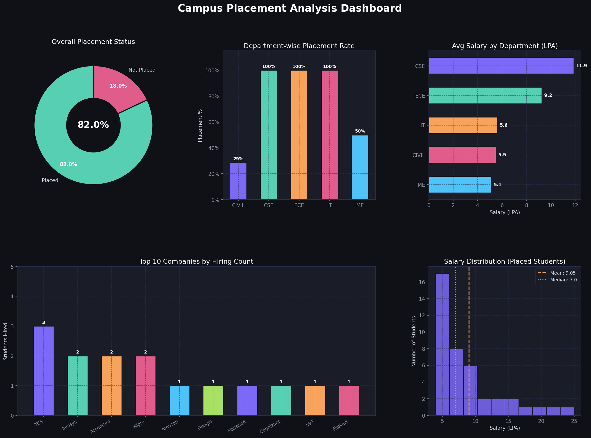
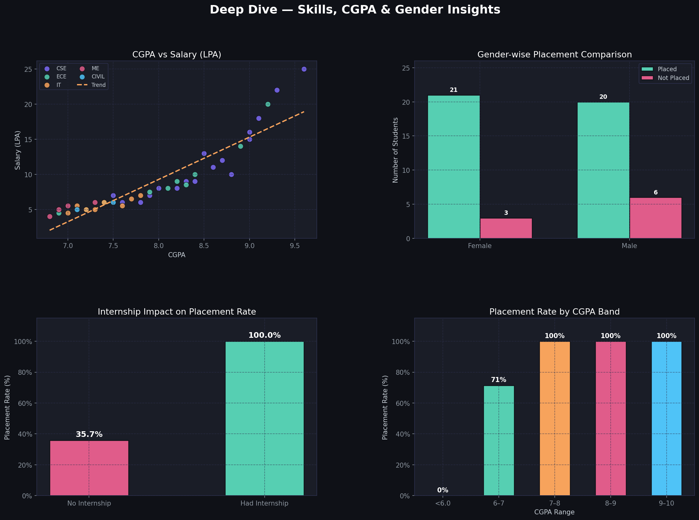

# Campus Placement Analysis

A Python-based data analysis project that explores student placement trends across departments, companies, CGPA bands, and more — with a dark-themed visual dashboard.

---

## Dashboards

### Overview Dashboard


> Covers overall placement rate, department-wise stats, top hiring companies, and salary distribution.

---

### Deep Dive Dashboard


> Explores CGPA vs salary correlation, gender comparison, internship impact, and CGPA band analysis.

---

## Features

- **Placement rate** - overall and per department
- **Salary analysis** - highest, average, median, and distribution histogram
- **Company insights** - top 10 recruiters by hiring count
- **CGPA vs Salary** - scatter plot with trend line, color-coded by department
- **Gender comparison** - placed vs not placed breakdown
- **Internship impact** - how having an internship affects placement odds
- **CGPA band analysis** - placement rate across score ranges (< 6, 6–7, 7–8, 8–9, 9–10)
- **Console report** - formatted summary with department table and top 5 packages

---

## Dataset

File: `placement_data.csv` - 50 student records

| Column | Description |
|---|---|
| `Student_ID` | Unique student identifier |
| `Name` | Student name |
| `Department` | CSE / ECE / IT / ME / CIVIL |
| `Company` | Hiring company (`None` if not placed) |
| `Salary_LPA` | Salary in Lakhs Per Annum (0 if not placed) |
| `Placed` | Yes / No |
| `CGPA` | Cumulative GPA (out of 10) |
| `Gender` | Male / Female |
| `Internship` | Whether the student had an internship (Yes / No) |
| `Skills` | Primary technical skill |

---

## Key Insights

| Metric | Value |
|---|---|
| Total Students | 50 |
| Placement Rate | 82% |
| Highest Salary | 25 LPA (Google) |
| Average Salary | 9.05 LPA |
| Median Salary | 7.0 LPA |
| Best Placed Dept | CSE (100%) |
| Top Recruiter | TCS |

---

## Tech Stack

- **Python 3.x**
- **Pandas** - data loading and aggregation
- **Matplotlib** - all charts and dashboards
- **NumPy** - trend line calculation

---

## Getting Started

**1. Install dependencies**
```bash
pip install pandas matplotlib numpy
```

**2. Run the analysis**
```bash
python placement_analysis.py
```

**3. Output**
- Console report printed to terminal
- `dashboard_overview.png` — saved to project root
- `dashboard_deepdive.png` — saved to project root

---

## Project Structure

```
├── placement_analysis.py        # Main analysis script
├── placement_data.csv           # Dataset (50 students)
├── dashboard_overview.png       # Overview dashboard
├── dashboard_deepdive.png       # Deep dive dashboard
└── README.md                    # This file
```
